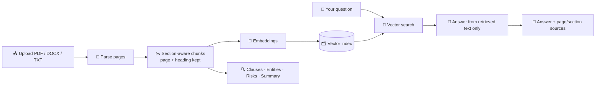

<div align="center">

# ⚖️ LegalLens

### AI Legal Document Analyzer

*Read contracts the way a lawyer would, and understand them the way you would.*


[Features](#-features) · [Quick Start](#-quick-start) · [How It Works](#-how-it-works) · [API](#-api) · [Samples](#-sample-documents) · [Roadmap](#-roadmap)

</div>

---

## 📖 About

**LegalLens** is an NLP and AI-based application that helps people understand legal documents. Upload a contract, NDA,
employment agreement or rental document, and LegalLens explains it in simple language, highlights the important and
risky parts, and answers your questions **using only what is written in the document**, with the exact page and
section shown as proof.

> ⚠️ **LegalLens is not legal advice.** It helps you understand a document; consult a qualified lawyer before signing.

## ✨ Features

| | Feature | What you get |
|---|---|---|
| 📄 | **Summarize** | Document type, plain-language overview, key sentences and key facts |
| 🔍 | **Important clauses** | 13 clause types (termination, payment, confidentiality, indemnity, liability, governing law and more), plus a list of expected clauses that are **missing** |
| 🧑‍⚖️ | **Entities** | Parties, roles, dates, money, durations, percentages, emails, jurisdictions (and people, organizations, places and laws with spaCy) |
| ⚠️ | **Risk detection** | 18 risky-clause patterns, each with a severity, a plain-English reason and the exact sentence. An overall **0–100 risk score** |
| 💬 | **Ask questions** | Chat with your document using RAG (Retrieval-Augmented Generation) |
| 📑 | **Source citations** | Every answer shows the **page and section** it came from |
| 🔄 | **Compare documents** | Sentence-level diff with highlighted word changes, changed amounts and dates, clause and risk differences |
| 📂 | **Multi-format** | Upload PDF, DOCX or TXT |

## 🚀 Quick Start

**Requirements:** Python 3.10 or newer.

### ⚡ One-click start

| System | Command |
|---|---|
| 🪟 Windows | Double-click **`run.bat`** |
| 🍎 Mac / 🐧 Linux | `./run.sh` |

Then open **http://localhost:8000**.

### 🛠️ Manual setup

```bash
# 1. Create and activate a virtual environment
python -m venv .venv
source .venv/bin/activate          # Windows: .venv\Scripts\activate

# 2. Install dependencies
pip install -r requirements.txt

# 3. Start the server
uvicorn app.main:app --reload
```

### 🔌 Optional upgrades

| Upgrade | Command | Benefit |
|---|---|---|
| 🧠 Better entity detection | `python -m spacy download en_core_web_sm` | Finds people, organizations, places, laws |
| 🤖 AI-written answers & summaries | `export ANTHROPIC_API_KEY=your-key` (Windows PowerShell: `$env:ANTHROPIC_API_KEY="your-key"`) | Natural-language answers that cite the document |
| 🔎 Semantic search | `pip install sentence-transformers` | Understands meaning, not just keywords |

> The app works without any of these. It falls back to keyword (TF-IDF) search and extractive answers.

### 🐳 Docker

```bash
docker build -t legallens .
docker run -p 8000:8000 -e ANTHROPIC_API_KEY=your-key legallens
```

### ✅ Run the tests

```bash
pip install pytest httpx
pytest -q
```

## 🧠 How It Works



1. **Parse**: the file becomes pages, then ~900-character chunks tagged with their page and section heading.
2. **Embed and index**: chunks are converted to vectors (MiniLM sentence-transformers, or TF-IDF fallback) and stored in a cosine-similarity index.
3. **Retrieve**: your question is embedded and the 4 closest chunks are found.
4. **Answer**: an LLM (if an API key is set) answers **only from those chunks** and cites them as `[1]`, `[2]`. Without a key, the best-matching sentences are returned instead.
5. **Show sources**: the page, section and match score for each chunk are displayed so you can verify the answer.

## 🗂️ Project Structure

```
legallens/
├── app/
│   ├── main.py        # FastAPI server and endpoints
│   ├── parser.py      # PDF/DOCX/TXT loading, pages, section-aware chunking
│   ├── nlp.py         # Entities, clauses, risk rules, summary
│   ├── rag.py         # Embeddings, vector store, question answering
│   └── compare.py     # Document comparison engine
├── static/
│   └── index.html     # Web interface
├── samples/           # Ready-to-use example documents
├── tests/             # Automated tests
├── run.bat / run.sh   # One-click start scripts
├── Dockerfile
└── requirements.txt
```

## 🔌 API

Interactive docs are available at **http://localhost:8000/docs** while the server runs.

| Method | Endpoint | Purpose |
|---|---|---|
| `POST` | `/api/upload` | Upload a document and get the full analysis |
| `GET` | `/api/docs/{id}` | Fetch a document's analysis again |
| `POST` | `/api/docs/{id}/ask` | Ask a question (`{"question": "..."}`) and get answer plus sources |
| `POST` | `/api/compare` | Compare two documents (`{"a": id, "b": id}`) |
| `GET` | `/api/health` | Server status |

## 📂 Sample Documents

Try these from the `samples/` folder:

| File | Shows |
|---|---|
| `nda_balanced.txt` | 🟢 A fair mutual NDA (low risk) |
| `nda_one_sided.txt` | 🔴 A predatory NDA (unlimited liability, perpetual secrecy, waived rights) |
| `employment_agreement.txt` / `.docx` | 🟠 Non-compete, IP assignment, short notice |
| `service_agreement.txt` / `.pdf` | 🟠 Auto-renewal, high late fees (PDF has 2 pages) |
| `rental_v1.txt` + `rental_v2.txt` | 🔄 A lease and its changed version, for **Compare** |

**Questions to try:** *"How long does confidentiality last?"* · *"What notice does the employer need to give?"* ·
*"What is the late fee?"* · *"Can the contract renew automatically?"*

## 🛠️ Customize

Risk and clause detection are driven by simple tables, so you can extend them without touching the logic:

- Add a risky pattern: append to `RISKS` in `app/nlp.py`
- Add a clause type: add an entry to `CLAUSES` in `app/nlp.py`
- Change the AI model: set `LEGALLENS_MODEL`

## ⚠️ Limitations

- Scanned PDFs (images) need OCR first, for example with `ocrmypdf`
- Documents are stored in memory and are lost when the server restarts
- Risk flags are rule-based heuristics, not a legal opinion
- Tested mainly on English-language agreements

## 🗺️ Roadmap

- [ ] OCR for scanned documents
- [ ] Persistent storage (database + FAISS / Chroma / pgvector)
- [ ] Export analysis as PDF report
- [ ] Multi-language support
- [ ] User accounts and saved document history

## 🧰 Tech Stack

**Backend:** Python · FastAPI · scikit-learn · NumPy · pypdf · python-docx
**AI/NLP:** sentence-transformers · spaCy · Anthropic API · RAG · vector search
**Frontend:** HTML · CSS · vanilla JavaScript

---

<div align="center">

Made to make legal documents less scary. 💙

</div>
